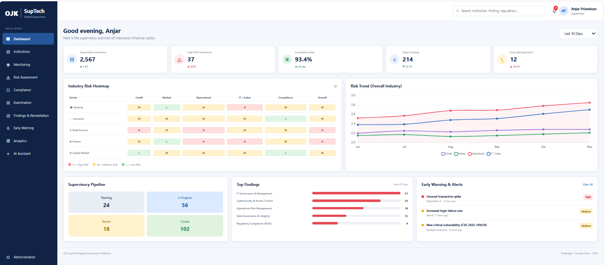
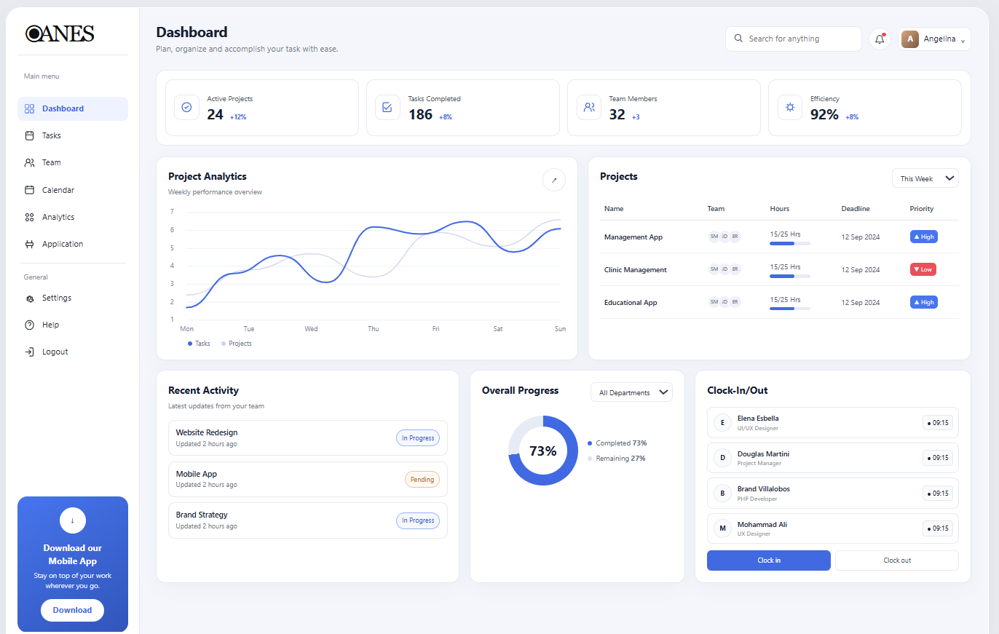

# Dashboard Design Prototypes

A collection of front-end dashboard prototypes exploring user interface (UI), user experience (UX), and information design for supervisory and operational applications.

This repository currently contains two standalone dashboard concepts: an **SupTech Dashboard** and an **Team & Task Management Dashboard**. Both are built with HTML, CSS, and JavaScript and can be viewed directly in a web browser.

## Projects

### 1. SupTech Dashboard

A Supervisory Technology (SupTech) dashboard concept for financial regulators. It presents a consolidated view of financial-sector supervision, institutional risk, supervisory activities, and early-warning indicators.

**Preview**



- **Live demo:** [Open SupTech Dashboard](https://priandoyo.github.io/design/dashboard-suptech.html)
- **Source code:** [dashboard-suptech.html](dashboard-suptech.html)
- **Screenshot:** [dashboard-suptech.png](dashboard-suptech.png)

**Dashboard components**
- Supervisory overview and institution portfolio indicators
- Financial-sector risk heatmap
- Industry risk trend visualization
- Supervisory pipeline and examination progress
- Findings overview
- Early-warning alerts
- Responsive layout for different screen sizes

### 2. Team & Task Management Dashboard

A team productivity and project management dashboard concept. It brings together project progress, task activity, team information, and attendance-related controls in one interface.

**Preview**



- **Live demo:** [Open Task Management Dashboard](https://priandoyo.github.io/design/dashboard-task-management.html)
- **Source code:** [dashboard-task-management.html](dashboard-task-management.html)
- **Screenshot:** [dashboard-task-management.png](dashboard-task-management.png)

**Dashboard components**
- Team and task summary indicators
- Project overview with status and progress
- Project activity and productivity visualizations
- Recent team activity
- Team progress overview
- Team member and attendance information
- Clock-in and clock-out interface
- Responsive layout for desktop and mobile screens

## Technology Stack

| Technology | Purpose |
|---|---|
| HTML5 | Page structure and semantic content |
| CSS3 | Layout, styling, and responsive design |
| JavaScript | Interface interactions and dashboard behavior |
| Chart.js | Data visualization in the SupTech dashboard |
| GitHub Pages | Static hosting for the live demos |

## Run Locally

No build step or package installation is required.

1. Clone the repository:

   ```bash
   git clone https://github.com/priandoyo/design.git
   cd design
   ```

2. Start a local web server:

   ```bash
   python -m http.server 8000
   ```

3. Open either dashboard:

   - http://localhost:8000/dashboard-suptech.html
   - http://localhost:8000/dashboard-task-management.html

You can also open the HTML files directly in a modern browser.

## Repository Structure

```text
design/
├── README.md
├── dashboard-suptech.html
├── dashboard-suptech.png
├── dashboard-task-management.html
└── dashboard-task-management.png
```

## Project Notes

- These projects are front-end prototypes intended for demonstration, UI/UX exploration, and learning.
- Dashboard figures, names, and records are illustrative sample data, not live institutional or business information.
- The prototypes do not represent production-ready supervisory or task management systems.
- Features and interface designs may change as the prototypes evolve.

## Author

**Anjar Priandoyo**

[GitHub Profile](https://github.com/priandoyo)

---

*Exploring dashboard design, web technologies, and digital solutions.*
